# O elenco das Ilhas Sevii

As fichas de quem vem pro Torneio das Ilhas, no pós-jogo (capítulos 33 a 38). Gerado por
`node ferramentas/fichas-sevii.js` a partir de `js/story/sevii-elenco.js` — mudou lá, roda de novo.
Cada pessoa tem a ficha no molde da inscrição de quem joga (traços, objetivo, o status forte, gostos,
aparência) e um rosto só dela, em `sprites_nds/npcs/trainers/`. O time vai do mais fraco ao ás, com
golpes, natureza e o item que o ás segura. O que fica pra depois (o gancho) é o fio de cada um pra outra região.

| | Nome | De onde | Classe | Especialidade |
|---|---|---|---|---|
| 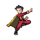 | Soren Larkspur | Blackthorn, Johto | Domador de Dragões | Dragão |
| 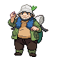 | Gideon Spruce | Olivine, Johto | Pescador | time variado |
| 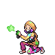 | Etta Hemlock | Azalea, Johto | Artesã de Pokébolas | Inseto |
| 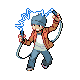 | Ziggy Bay | Goldenrod, Johto | Radialista | time variado |
| 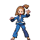 | Saskia Rush | Cianwood, Johto | Lutadora | time variado |
| 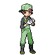 | Florian Ashgrove | Rota 34, Johto | Criador Pokémon | time variado |
| 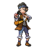 | Zev Fernley | Mahogany, Johto | Pescador do Lago | time variado |
| 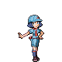 | Skye Fernwood | Fortree, Hoenn | Escaladora | time variado |
| 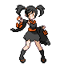 | Petra Sumac | Lavaridge, Hoenn | Dona de Termas | time variado |
| 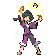 | Imogen Vetch | Mossdeep, Hoenn | Astrônoma | time variado |
| 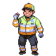 | Brody Teak | Slateport, Hoenn | Estivador | time variado |
| 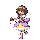 | Esme Wisteria | Lilycove, Hoenn | Coordenadora | time variado |
| 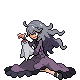 | Oona Yew | Monte Pyre, Hoenn | Zeladora do Monte Pyre | Fantasma |
| 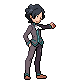 | Rhys Ironwood | Sootopolis, Hoenn | Ás de Hoenn | time variado |
| 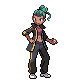 | Noa Kelp | Ilha Um, Ilhas Sevii | Moça do Cais | time variado |
| 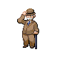 | Magnus Holm | Ilha Sete, Ilhas Sevii | Bicampeão das Ilhas | time variado |

## Soren Larkspur

- **Domador de Dragões** · 19 anos · homem · nasceu em 2 de novembro
- **De:** Blackthorn, Johto
- **Especialidade:** tipo Dragão
- **Traços:** teimoso, solitário, leal
- **Objetivo:** crescer junto com o seu time
- **Status forte:** Resistência
- **Gosta de:** montanha, tipo Dragão, Salamence
- **Não gosta de:** cidade, tipo Gelo, Glalie
- **Aparência:** Alto e magro, cabelo curto azul-escuro penteado pra trás, roupa justa vinho de domador e a capa comprida com o forro dourado, gasta na barra de tanto arrastar em pedra.
- **Jeito de falar:** Frase curta. Fala de dragão como quem fala de gente da família, e nunca levanta a voz.

**A jornada.** Nasceu no Covil dos Dragões de Blackthorn, filho de um guardião do santuário. Aos nove anos trocou o Rattata do irmão por um ovo com um marinheiro de Hoenn, no porto de Olivine. Do ovo saiu um Bagon. Os anciãos do clã não deixaram o Bagon entrar no Covil: dragão que não nasceu da água de lá, disseram, não é dragão. Ele saiu de Blackthorn aos treze com o Bagon no colo, fez o desafio de Hoenn e foi barrado no fim. O Bagon virou Salamence no dia da segunda recusa do clã. O Dragonair é o único do Covil que saiu com ele. O pai deu na porta, sem o clã ver.

**Por que veio.** O Torneio das Ilhas é o único grande que não tem cadeira do clã no júri. Aqui ninguém pergunta de onde veio o dragão.

**O que fica pra depois.** Dizem que o clã mandou alguém assistir o torneio. Ele finge que não procura na arquibancada.

**Time** (do mais fraco ao ás):

| Pokémon | Tipo | Região | Golpes | Natureza | Item |
|---|---|---|---|---|---|
| Dragonair | Dragão | Kanto | Dragon Breath, Thunder Wave, Surf, Ice Beam | Modest | — |
| Kingdra | Água/Dragão | Johto | Surf, Dragon Breath, Ice Beam, Agility | Modest | — |
| Aerodactyl | Pedra/Voador | Kanto | Rock Slide, Earthquake, Ancient Power, Fly | Jolly | — |
| Flygon | Terrestre/Dragão | Hoenn | Earthquake, Dragon Claw, Rock Slide, Fire Blast | Jolly | — |
| Dragonite | Dragão/Voador | Kanto | Outrage, Fly, Thunder Wave, Fire Blast | Adamant | — |
| Salamence | Dragão/Voador | Hoenn | Dragon Claw, Crunch, Fly, Flamethrower | Naive | Dragon Scale |

**No torneio:** "Ele não nasceu no Covil. Nasceu numa caixa de papelão no porto de Olivine. Vem." · **quando ganha:** "Não foi contra você. Foi a favor dele." · **quando perde:** "Ele voou do mesmo jeito. Era isso que eu vim ver."

**No cais do Anne:** "O Salamence quer ir voando até Blackthorn. Eu deixo. Se o clã perguntar, foi ele que quis."

**De longe, no PokéNav:** "O Salamence pousou no telhado do santuário de Blackthorn ontem. Ninguém mandou ele descer." · "Meu pai veio ver o Dragonair. Não falou do clã. Falou do tempo. Foi bom." · "Tem neve na montanha daqui. O Salamence gosta de neve. Eu não."

## Gideon Spruce

- **Pescador** · 71 anos · homem · nasceu em 30 de março
- **De:** Olivine, Johto
- **Especialidade:** time variado
- **Traços:** paciente, brincalhão, teimoso
- **Objetivo:** ser campeão/campeã
- **Status forte:** Sorte
- **Gosta de:** água, tipo Água, Lapras
- **Não gosta de:** cidade, tipo Elétrico, Qwilfish
- **Aparência:** Velho barrigudo de barba branca, chapéu de pano branco, colete azul de bolso cheio e a mochila de pesca nas costas, com a vara de bambu atravessada.
- **Jeito de falar:** Conta tudo como causo, no ritmo de quem espera a linha puxar. Chama todo mundo de moço e de moça.

**A jornada.** Pesca no cais de Olivine há cinquenta e tantos anos. Veio ao Torneio das Ilhas pela primeira vez com dezenove anos e um Lapras novo, e perdeu a final pro Magnus Holm, da Ilha Sete. Voltou em todas as edições desde então: quarenta e duas. Nunca ganhou. O Lapras é o mesmo. O resto do time é o que o cais juntou em cinquenta anos: o Noctowl da pesca de madrugada, o Sudowoodo que todo mundo acha que é árvore, o Omastar que veio fóssil numa rede.

**Por que veio.** "Tem gente que vem pelo torneio. Eu venho pelo barco." É o primeiro ano sem a mulher dele acenando do cais de Olivine na saída.

**O que fica pra depois.** Guarda um mapa de pesca de Johto com marcas a lápis nos lugares onde, diz ele, o mar canta.

**Time** (do mais fraco ao ás):

| Pokémon | Tipo | Região | Golpes | Natureza | Item |
|---|---|---|---|---|---|
| Noctowl | Normal/Voador | Johto | Hypnosis, Dream Eater, Psychic, Fly | Modest | — |
| Slowking | Água/Psíquico | Johto | Surf, Psychic, Ice Beam, Amnesia | Calm | — |
| Skarmory | Metálico/Voador | Johto | Steel Wing, Drill Peck, Agility, Swift | Impish | — |
| Sudowoodo | Pedra | Johto | Rock Slide, Earthquake, Body Slam, Self-Destruct | Adamant | — |
| Omastar | Pedra/Água | Kanto | Surf, Ancient Power, Ice Beam, Spike Cannon | Modest | — |
| Lapras | Água/Gelo | Kanto | Surf, Ice Beam, Body Slam, Psychic | Calm | Leftovers |

**No torneio:** "Quarenta e duas vezes eu entrei nesta arena, moço. Em quarenta e uma eu saí com o barco cheio de história e sem troféu." · **quando ganha:** "Viu? O mar devolve. Demora, mas devolve." · **quando perde:** "Quarenta e três. Número bonito. Ano que vem eu volto."

**No cais do Anne:** "Ano que vem tem outro torneio e outro barco, moço/moça. Eu vou nos dois."

**De longe, no PokéNav:** "O mar de Olivine tá calmo, moço/moça. Calmo demais: nem Magikarp. Eu fico olhando a linha assim mesmo." · "O Lapras pegou mania de esperar o barco das ilhas no fim do cais. Toda tarde. Eu não tenho coragem de explicar que é só ano que vem." · "Contei no cais de Olivine das ilhas e de você. Ninguém acreditou em nada. É assim que se sabe que o causo é bom."

## Etta Hemlock

- **Artesã de Pokébolas** · 14 anos · mulher · nasceu em 14 de junho
- **De:** Azalea, Johto
- **Especialidade:** tipo Inseto
- **Traços:** orgulhosa, curiosa, determinada
- **Objetivo:** voltar pra casa com orgulho
- **Status forte:** Intelecto
- **Gosta de:** floresta, tipo Inseto, Heracross
- **Não gosta de:** vulcão, tipo Fogo, Slowpoke
- **Aparência:** Cabelo loiro preso, roupa colorida manchada de tinta, sempre ajoelhada com a tinta verde da Apricorn na mão e a mochila cheia de Pokébolas penduradas por fora.
- **Jeito de falar:** Rápida e técnica. Explica a costura de uma Pokébola sem ninguém pedir e corrige quem diz "Pokébola comum".

**A jornada.** A família dela faz Pokébola de Apricorn em Azalea há quatro gerações, na rua de baixo da do mestre famoso. Todo mundo conhece a rua de cima. Ninguém conhece a de baixo. Fez o desafio de Johto só com Pokémon que ela mesma pegou com as Pokébolas da família. Carrega oitenta e quatro Pokébolas feitas à mão. Sabe o dia em que fez cada uma.

**Por que veio.** Vender as Pokébolas na feira do torneio (quem vem de Hoenn nunca viu uma Apricorn) e provar que inseto ganha torneio.

**O que fica pra depois.** Quer abrir uma banca da família em Lilycove, do outro lado do mar.

**Time** (do mais fraco ao ás):

| Pokémon | Tipo | Região | Golpes | Natureza | Item |
|---|---|---|---|---|---|
| Ninjask | Inseto/Voador | Hoenn | Slash, Fury Cutter, Swords Dance, Double-Edge | Jolly | — |
| Pinsir | Inseto | Kanto | Swords Dance, Body Slam, Earthquake, Rock Slide | Jolly | — |
| Forretress | Inseto/Metálico | Johto | Earthquake, Explosion, Rapid Spin, Protect | Relaxed | — |
| Heracross | Inseto/Lutador | Johto | Megahorn, Earthquake, Body Slam, Swords Dance | Adamant | — |
| Armaldo | Pedra/Inseto | Hoenn | Rock Slide, Earthquake, Fury Cutter, Swords Dance | Adamant | — |
| Scizor | Inseto/Metálico | Johto | Metal Claw, Fury Cutter, Swords Dance, Quick Attack | Adamant | Metal Coat |

**No torneio:** "Cada Pokébola dessas eu fiz com a mão. Se eu perder, pelo menos você viu o acabamento." · **quando ganha:** "Inseto! Escreve aí: inseto!" · **quando perde:** "Tá. Mas olha a costura da Pokébola que você usou. Agora olha a minha."

**No cais do Anne:** "Guarda isso: Pokébola de Apricorn não é Pokébola comum. Se alguém disser que é, você corrige."

**De longe, no PokéNav:** "Vendi trinta e duas Pokébolas na feira das ilhas. Trinta e duas! A rua de cima de Azalea ficou sabendo." · "Tô costurando uma Pokébola nova, verde-escura, com costura dupla. Ainda não tem nome. Quando tiver, você é a segunda a saber." · "Escrevi pra Lilycove perguntando quanto custa uma banca na praia. Responderam com um número que eu não vou repetir."

## Ziggy Bay

- **Radialista** · 28 anos · homem · nasceu em 1 de abril
- **De:** Goldenrod, Johto
- **Especialidade:** time variado
- **Traços:** alegre, competitivo, sonhador
- **Objetivo:** ter poder e dinheiro
- **Status forte:** Carisma
- **Gosta de:** cidade, tipo Normal, Miltank
- **Não gosta de:** caverna, tipo Fantasma, Misdreavus
- **Aparência:** Topete azul espetado que não se mexe com vento nenhum, jaqueta marrom aberta e o fio do microfone girando na mão.
- **Jeito de falar:** Fala como quem está no ar: em vinheta, chamando todo mundo de ouvinte. Quando o microfone desliga, fica quieto de repente.

**A jornada.** Apresenta "Ziggy na Madrugada" na rádio de Goldenrod há seis anos, o programa que todo caminhoneiro de Johto escuta da meia-noite às quatro. A rádio vai tirar o programa do ar daqui a três meses. Ninguém mais escuta rádio de madrugada, diz o diretor. Dois do time vieram de ouvinte: o Lanturn, de um caminhoneiro de Cianwood; o Typhlosion, de um menino de New Bark que ligou chorando porque ia se mudar pra longe.

**Por que veio.** Narrar o torneio ao vivo, lutando nele, num transmissor de mão. Se o Ziggy da madrugada ganhar o Torneio das Ilhas, a rádio não tem coragem de tirar do ar.

**O que fica pra depois.** Promete uma entrevista com você "no programa", se o programa existir.

**Time** (do mais fraco ao ás):

| Pokémon | Tipo | Região | Golpes | Natureza | Item |
|---|---|---|---|---|---|
| Jynx | Gelo/Psíquico | Kanto | Ice Beam, Psychic, Lovely Kiss, Dream Eater | Modest | — |
| Lanturn | Água/Elétrico | Johto | Thunderbolt, Surf, Thunder Wave, Confuse Ray | Modest | — |
| Typhlosion | Fogo | Johto | Flamethrower, Earthquake, Thunder Punch, Quick Attack | Naive | — |
| Ampharos | Elétrico | Johto | Thunderbolt, Fire Punch, Thunder Wave, Light Screen | Modest | — |
| Miltank | Normal | Johto | Body Slam, Earthquake, Rollout, Attract | Careful | — |
| Exploud | Normal | Hoenn | Body Slam, Earthquake, Flamethrower, Ice Beam | Lonely | Muscle Band |

**No torneio:** "Boa tarde, ouvinte! Agora é comigo e com o/a visitante de Kanto, ao vivo das ilhas!" · **quando ganha:** "E É DO ZIGGY! Repete pro pessoal de Ecruteak que não acreditou!" · **quando perde:** "…e o Ziggy cai, ouvinte. Mas cai bonito. Fica com a gente que depois do intervalo tem mais."

**No cais do Anne:** "Ouvinte, aqui é o Ziggy, saindo das ilhas no último barco. Da meia-noite às quatro, fica com a gente."

**De longe, no PokéNav:** "Ouvinte! O programa não saiu do ar. Ainda. Toquei a gravação do torneio três madrugadas seguidas e os caminhoneiros pediram bis." · "O diretor da rádio me chamou na sala. Achei que era o fim. Era pra perguntar se tinha mais gravação das ilhas." · "Um caminhoneiro de Ecruteak ligou no programa perguntando de você. Eu disse que você tava bem. Eu tô certo?"

## Saskia Rush

- **Lutadora** · 22 anos · mulher · nasceu em 8 de agosto
- **De:** Cianwood, Johto
- **Especialidade:** time variado
- **Traços:** corajosa, alegre, impulsiva
- **Objetivo:** ser campeão/campeã
- **Status forte:** Força
- **Gosta de:** água, tipo Lutador, Hariyama
- **Não gosta de:** cidade, tipo Psíquico, Alakazam
- **Aparência:** Cabelo castanho preso, quimono azul de treino com a faixa amarrada duas vezes, descalça, os braços cheios de arranhão de rocha.
- **Jeito de falar:** Ri alto, fala com o corpo inteiro e cumprimenta apertando o braço, não a mão.

**A jornada.** Cresceu no dojô de Cianwood. Nada até as Ilhas do Redemoinho toda manhã, ida e volta antes do café. Passou um ano em Hoenn treinando com os lutadores de Dewford e voltou com um Makuhita, hoje Hariyama: o único Pokémon que a derrubou na areia. De manhã, quem nada com ela são o Mantine e o Feraligatr. Luta não é tipo, diz ela: é quem levanta depois de cair.

**Por que veio.** Lutar de novo com quem vem de Hoenn. E porque a mãe dela disse que ela nunca termina nada. "Eu vim terminar um torneio."

**O que fica pra depois.** Quer atravessar o mar entre Cianwood e as Ilhas Sevii nadando, um dia. Já calculou as paradas.

**Time** (do mais fraco ao ás):

| Pokémon | Tipo | Região | Golpes | Natureza | Item |
|---|---|---|---|---|---|
| Feraligatr | Água | Johto | Waterfall, Slash, Earthquake, Ice Punch | Adamant | — |
| Mantine | Água/Voador | Johto | Surf, Wing Attack, Ice Beam, Confuse Ray | Calm | — |
| Zangoose | Normal | Hoenn | Swords Dance, Slash, Shadow Ball, Rock Slide | Adamant | — |
| Hitmontop | Lutador | Johto | Rolling Kick, Dig, Quick Attack, Detect | Impish | — |
| Donphan | Terrestre | Johto | Earthquake, Rock Slide, Body Slam, Rapid Spin | Adamant | — |
| Hariyama | Lutador | Hoenn | Seismic Toss, Earthquake, Rock Slide, Fire Punch | Adamant | Focus Band |

**No torneio:** "Aperta aqui. Não, de verdade. Eu quero saber a força da mão de quem eu vou enfrentar." · **quando ganha:** "HA! Isso! Agora a gente vai nadar, os dois. É assim que se agradece." · **quando perde:** "Ai. Essa entrou. Entrou bonito. Me mostra de novo como foi?"

**No cais do Anne:** "Aperta aqui. Mais forte. Isso. Agora vai, que o barco não espera e até Cianwood eu ainda não nado."

**De longe, no PokéNav:** "Nadei ida e volta antes do café, como sempre. Contei as braçadas. Faltam umas seiscentas mil pra chegar nas ilhas." · "O dojô de Cianwood pediu pra eu contar do torneio. Eu contei lutando. Ninguém entendeu, mas todo mundo suou." · "Minha mãe disse que eu terminei um torneio. Eu disse que ainda não terminei nada. Ela riu."

## Florian Ashgrove

- **Criador Pokémon** · 34 anos · homem · nasceu em 22 de setembro
- **De:** Rota 34, Johto
- **Especialidade:** time variado
- **Traços:** organizado, observador, cauteloso
- **Objetivo:** crescer junto com o seu time
- **Status forte:** Intelecto
- **Gosta de:** campo, tipo Normal, Eevee
- **Não gosta de:** vulcão, tipo Fantasma, Ditto
- **Aparência:** Boné claro, roupa de trabalho verde de jardineiro e um ovo nas duas mãos, segurado como quem segura vidro.
- **Jeito de falar:** Fala em porcentagem e depois pede desculpa por falar em porcentagem.

**A jornada.** Neto do casal que cuida da creche da Rota 34. Cresceu entre ovo e cesto de palha. Cria Eevee há vinte anos e anota tudo em caderno: a temperatura do ovo, o dia, a hora em que rachou. Cinco dos seis do time dele são da mesma linhagem, filhos e netos de uma Eevee só, que mora na creche até hoje. O Snorlax também é da creche: dorme no portão desde antes de ele nascer.

**Por que veio.** A creche faz cinquenta anos. Ele trouxe seis ovos da linhagem pra dar de presente a quem chegar na final, que é a tradição dele em todo torneio.

**O que fica pra depois.** Quer ver um Eevee da linhagem dele crescer em Hoenn, com alguém de lá.

**Time** (do mais fraco ao ás):

| Pokémon | Tipo | Região | Golpes | Natureza | Item |
|---|---|---|---|---|---|
| Snorlax | Normal | Kanto | Body Slam, Earthquake, Shadow Ball, Curse | Adamant | — |
| Vaporeon | Água | Kanto | Surf, Ice Beam, Acid Armor, Body Slam | Bold | — |
| Jolteon | Elétrico | Kanto | Thunderbolt, Thunder Wave, Pin Missile, Shadow Ball | Timid | — |
| Flareon | Fogo | Kanto | Flamethrower, Body Slam, Shadow Ball, Quick Attack | Adamant | — |
| Umbreon | Sombrio | Johto | Faint Attack, Confuse Ray, Toxic, Protect | Careful | — |
| Espeon | Psíquico | Johto | Psychic, Shadow Ball, Swift, Reflect | Timid | Wise Glasses |

**No torneio:** "Eles vieram da mesma avó. Cada um escolheu um caminho. Igual a gente." · **quando ganha:** "Noventa e um por cento, eu tinha calculado. Desculpa. Eu sempre calculo." · **quando perde:** "Anotado. Não é derrota, é dado."

**No cais do Anne:** "Oitenta e sete por cento de chance de eu voltar ano que vem. Desculpa. Eu sempre calculo."

**De longe, no PokéNav:** "A Eevee da creche botou um ovo na semana em que eu voltei. Anotei a hora: quatro e doze da manhã. Desculpa o detalhe." · "Meus avós querem saber quem é você. Eu disse: alguém que cuida. Eles disseram que isso basta." · "Um dos ovos da linhagem foi pra Hoenn, com uma família de Petalburg. Noventa e quatro por cento de chance de dar certo. Eu fiquei feliz em cem."

## Zev Fernley

- **Pescador do Lago** · 31 anos · homem · nasceu em 13 de dezembro
- **De:** Mahogany, Johto
- **Especialidade:** time variado
- **Traços:** desconfiado, solitário, protetor
- **Objetivo:** proteger quem precisa
- **Status forte:** Percepção
- **Gosta de:** água, tipo Sombrio, Houndoom
- **Não gosta de:** cidade, tipo Psíquico, Raticate
- **Aparência:** Cabelo preto comprido preso, barba de semanas, jaqueta marrom de viagem e uma Pokébola sempre na mão, nunca no cinto.
- **Jeito de falar:** Fala pouco, olha nos olhos. Nunca diz "nós" quando fala da Equipe Rocket: diz "eles", mesmo quando era "nós".

**A jornada.** Há três anos era recruta da Equipe Rocket no esconderijo de Mahogany, o que ficava debaixo da loja de lembrancinhas. Quando o esconderijo caiu, ele não fugiu: ficou pra abrir as gaiolas. Pegou dois anos. Saiu e vive de pesca no Lago da Fúria. Do time de antes, falta um. No lugar dele está o Gyarados do Lago, que mordeu a linha numa terça de chuva e é o único que nunca viu uniforme.

**Por que veio.** Torneio é a única coisa em que ninguém pergunta o que ele fez. Ou era.

**O que fica pra depois.** Tem um nome que ele não diz: o do chefe de turno de Mahogany, que fugiu antes da polícia chegar.

**Time** (do mais fraco ao ás):

| Pokémon | Tipo | Região | Golpes | Natureza | Item |
|---|---|---|---|---|---|
| Weezing | Venenoso | Kanto | Sludge Bomb, Flamethrower, Thunderbolt, Shadow Ball | Bold | — |
| Gyarados | Água/Voador | Kanto | Waterfall, Earthquake, Body Slam, Dragon Breath | Adamant | — |
| Crobat | Venenoso/Voador | Johto | Wing Attack, Sludge Bomb, Confuse Ray, Bite | Jolly | — |
| Piloswine | Gelo/Terrestre | Johto | Earthquake, Ice Beam, Rock Slide, Body Slam | Brave | — |
| Houndoom | Sombrio/Fogo | Johto | Flamethrower, Crunch, Shadow Ball, Sludge Bomb | Timid | — |
| Tyranitar | Pedra/Sombrio | Johto | Crunch, Rock Slide, Earthquake, Thunderbolt | Adamant | Leftovers |

**No torneio:** "Pode olhar. Todo mundo olha. Eu prefiro que olhe de frente." · **quando ganha:** "Não foi sorte. Eu treinei mais que todo mundo aqui, porque eu comecei atrasado." · **quando perde:** "Foi limpo. Pra mim isso é muito."

**No cais do Anne:** "Obrigado por ter olhado de frente. Do barco até aqui."

**De longe, no PokéNav:** "O lago tá calmo. Peguei três Magikarp e soltei os três." · "Abriram uma loja nova do lado da de lembrancinhas. Eu passo na frente todo dia. É só uma loja. Eu confiro mesmo assim." · "O Houndoom dorme na porta de casa agora. Não deixa ninguém chegar perto do portão sem ele ver primeiro."

## Skye Fernwood

- **Escaladora** · 15 anos · mulher · nasceu em 20 de maio
- **De:** Fortree, Hoenn
- **Especialidade:** time variado
- **Traços:** sonhadora, distraída, alegre
- **Objetivo:** conhecer Kanto inteira
- **Status forte:** Sorte
- **Gosta de:** floresta, tipo Voador, Altaria
- **Não gosta de:** água, tipo Elétrico, Sharpedo
- **Aparência:** Boné azul-céu, cabelo curto, roupa de trilha azul com o joelho ralado e uma pena de Swablu presa atrás da orelha.
- **Jeito de falar:** Fala olhando pro céu e conta o vento. Se distrai no meio da frase quando passa alguma coisa voando.

**A jornada.** Cresceu nas casas de árvore de Fortree, onde a rua é ponte de corda. Nunca tinha pisado num barco antes desta viagem. Enjoou as trinta horas de Slateport até aqui. O Altaria dela era um Swablu que ficou pra trás numa tempestade, na migração de outono, e ela cuidou dele no telhado de casa. O Absol apareceu na véspera daquela tempestade, na ponte de corda, e não foi mais embora. O Kecleon é o que fechava o caminho na saída de Fortree, que só ela enxergava.

**Por que veio.** A migração. Os Swablu de Hoenn atravessam o mar até as Ilhas Sevii no outono, e ela quer ver eles chegarem. O torneio é o que dá pra fazer enquanto eles descansam.

**O que fica pra depois.** Jura que um dia vai seguir a migração inteira, de Fortree até onde ela acaba.

**Time** (do mais fraco ao ás):

| Pokémon | Tipo | Região | Golpes | Natureza | Item |
|---|---|---|---|---|---|
| Kecleon | Normal | Hoenn | Shadow Ball, Thunderbolt, Body Slam, Ice Beam | Brave | — |
| Tropius | Grama/Voador | Hoenn | Razor Leaf, Fly, Body Slam, Synthesis | Careful | — |
| Xatu | Psíquico/Voador | Johto | Psychic, Night Shade, Confuse Ray, Steel Wing | Timid | — |
| Golem | Pedra/Terrestre | Kanto | Earthquake, Rock Slide, Body Slam, Rollout | Adamant | — |
| Absol | Sombrio | Hoenn | Slash, Swords Dance, Faint Attack, Iron Tail | Adamant | — |
| Altaria | Dragão/Voador | Hoenn | Dragon Claw, Fly, Flamethrower, Ice Beam | Jolly | Leftovers |

**No torneio:** "Vento de sudoeste hoje. Bom pra voar. Ruim pra você." · **quando ganha:** "Eles chegam na quinta. Você vem ver?" · **quando perde:** "Tudo bem. Daqui eu vejo o céu inteiro do mesmo jeito."

**No cais do Anne:** "Os Swablu saíram do mar ontem de noite. Você viu? Não? Ano que vem você vê."

**De longe, no PokéNav:** "Os Swablu voltaram pra Fortree hoje. Contei quarenta e um. Um a menos que no ano passado. Fiquei olhando o céu até escurecer." · "Vento leste aqui. Ruim pra voar, bom pra pensar. Pensei nas ilhas." · "Tô juntando dinheiro pra seguir a migração inteira. Já tenho o do primeiro barco. Faltam os outros onze."

## Petra Sumac

- **Dona de Termas** · 24 anos · mulher · nasceu em 5 de janeiro
- **De:** Lavaridge, Hoenn
- **Especialidade:** time variado
- **Traços:** orgulhosa, impulsiva, prática
- **Objetivo:** voltar pra casa com orgulho
- **Status forte:** Carisma
- **Gosta de:** vulcão, tipo Fogo, Torkoal
- **Não gosta de:** água, tipo Água, Wailord
- **Aparência:** Cabelo preto em duas mechas, quimono preto com a faixa cor de brasa e o leque fechado na mão como quem segura uma régua.
- **Jeito de falar:** Afiada e educada ao mesmo tempo. Negocia tudo, até o preço do chá, e sorri do jeito que corta.

**A jornada.** Herdou da avó a pousada de termas mais velha de Lavaridge. Desde que o vulcão de lá entrou em repouso os turistas sumiram, e as termas novas da beira-mar levaram o resto. Ela tem três funcionários, um telhado que pinga e a foto da avó na parede da recepção. O time trabalha na pousada: o Torkoal esquenta a água, o Grumpig serve o chá, o Sandslash cuida do banho de areia, o Breloom da casa de ervas e o Persian da recepção, que sabe o preço de tudo.

**Por que veio.** O prêmio paga a reforma do telhado. E ela veio olhar as termas da Estrada da Brasa, na Ilha Um, "a concorrência", de perto.

**O que fica pra depois.** Quer comprar uma fonte termal fora de Hoenn. Já perguntou o preço de três.

**Time** (do mais fraco ao ás):

| Pokémon | Tipo | Região | Golpes | Natureza | Item |
|---|---|---|---|---|---|
| Persian | Normal | Kanto | Slash, Pay Day, Bite, Shadow Ball | Jolly | — |
| Grumpig | Psíquico | Hoenn | Psychic, Shadow Ball, Ice Punch, Confuse Ray | Calm | — |
| Sandslash | Terrestre | Kanto | Earthquake, Slash, Rock Slide, Swords Dance | Jolly | — |
| Breloom | Grama/Lutador | Hoenn | Dynamic Punch, Giga Drain, Stun Spore, Swords Dance | Adamant | — |
| Torkoal | Fogo | Hoenn | Flamethrower, Body Slam, Rock Slide, Curse | Bold | — |
| Blaziken | Fogo/Lutador | Hoenn | Fire Blast, Earthquake, Rock Slide, Double Kick | Naive | Muscle Band |

**No torneio:** "Eu cobro entrada de quem vem ver o meu Blaziken. Hoje é cortesia." · **quando ganha:** "Isso vai pra parede da pousada. Do lado da foto da minha avó." · **quando perde:** "Tudo bem. Passa lá em casa um dia. Banho de graça pra quem me ganhou."

**No cais do Anne:** "Passa em Lavaridge um dia. Banho de graça pra quem me conhece. Pra quem me ganhou também: eu não guardo rancor de cliente."

**De longe, no PokéNav:** "Consertei o telhado. Com o dinheiro das ilhas e um desconto que eu arranquei do carpinteiro na conversa. Ele ainda não sabe como." · "As termas da beira-mar abaixaram o preço. Eu não. Eu pus a foto da minha avó maior na recepção." · "Um hóspede de Kanto perguntou se eu conhecia você. Eu disse que sim, e cobrei a diária inteira dele mesmo assim."

## Imogen Vetch

- **Astrônoma** · 31 anos · mulher · nasceu em 11 de agosto
- **De:** Mossdeep, Hoenn
- **Especialidade:** time variado
- **Traços:** calma, observadora, curiosa
- **Objetivo:** completar a Pokédex
- **Status forte:** Intelecto
- **Gosta de:** montanha, tipo Psíquico, Lunatone
- **Não gosta de:** cidade, tipo Sombrio, Murkrow
- **Aparência:** Cabelo preto preso, roupa folgada cor de vinho de quem passa a noite no telhado, as mãos erguidas com duas Pokébolas brilhando.
- **Jeito de falar:** Precisa e seca. Ri sem som, mede distância em coisa que ninguém mede e responde pergunta com outra.

**A jornada.** Calcula órbita de satélite no centro espacial de Mossdeep. O Lunatone e o Solrock dela vieram de um meteorito, no fundo das Cataratas do Meteoro. Ela estava lá no dia em que acharam. O Porygon2 roda o programa de órbita do centro espacial, e o Magneton segura a antena quando venta. O Clefable veio de Kanto, de um monte onde dizem que eles caíram do céu.

**Por que veio.** Uma chuva de meteoros que, este ano, só se vê inteira do sul do arquipélago. O torneio cai na mesma semana e paga a passagem. "É a desculpa que eu dei pro meu chefe."

**O que fica pra depois.** Quer subir uma montanha de Johto que, diz ela, tem o céu mais limpo do mundo.

**Time** (do mais fraco ao ás):

| Pokémon | Tipo | Região | Golpes | Natureza | Item |
|---|---|---|---|---|---|
| Clefable | Normal | Kanto | Ice Beam, Thunderbolt, Flamethrower, Sing | Calm | — |
| Magneton | Elétrico | Kanto | Thunderbolt, Thunder Wave, Tri Attack, Swift | Modest | — |
| Solrock | Pedra/Psíquico | Hoenn | Psychic, Flamethrower, Rock Slide, Earthquake | Adamant | — |
| Porygon2 | Normal | Johto | Tri Attack, Ice Beam, Thunderbolt, Recover | Modest | — |
| Lunatone | Pedra/Psíquico | Hoenn | Psychic, Ice Beam, Hypnosis, Rock Slide | Modest | — |
| Metagross | Metálico/Psíquico | Hoenn | Psychic, Earthquake, Metal Claw, Thunder Punch | Adamant | Metal Coat |

**No torneio:** "Faltam quatro noites pra chuva. Eu não pretendo perder nenhuma delas." · **quando ganha:** "Previsível. Bonito do jeito que órbita é bonita." · **quando perde:** "Interessante. Eu errei a conta em algum lugar. Vou achar onde."

**No cais do Anne:** "A chuva de meteoros foi boa. Você estava olhando pra arena, eu sei. Ninguém é perfeito."

**De longe, no PokéNav:** "O satélite que eu calculo passou por cima das ilhas ontem. Seis minutos e doze segundos. Pensei em você em quatro deles." · "Meu chefe perguntou da desculpa da passagem. Mostrei as fotos da chuva de meteoros. Ele parou de perguntar." · "O Lunatone fica olhando pro sul de noite, desde que a gente voltou. Eu não sei o que ele procura. Nem ele, acho."

## Brody Teak

- **Estivador** · 38 anos · homem · nasceu em 27 de julho
- **De:** Slateport, Hoenn
- **Especialidade:** time variado
- **Traços:** protetor, impulsivo, leal
- **Objetivo:** proteger quem precisa
- **Status forte:** Força
- **Gosta de:** água, tipo Água, Wailord
- **Não gosta de:** cidade, tipo Elétrico, Pelipper
- **Aparência:** Ombro largo, capacete laranja de estiva, colete refletivo amarelo, luva grossa e a âncora tatuada no braço.
- **Jeito de falar:** Grita ordem como quem fala normal, chama todo mundo de chefia e chora fácil, sem vergonha nenhuma.

**A jornada.** Estivador do cais de Slateport há vinte anos e delegado do sindicato. Trouxe os doze homens da turma dele numa vaquinha de seis meses. É a primeira viagem da turma inteira na vida. O time dele é o do cais: o Machamp que levanta o que o guindaste não alcança, o Ursaring do turno da noite, o Mightyena que dorme na porta do galpão.

**Por que veio.** A turma. Ganhar importa menos do que voltar com todo mundo, e com os Pokémon de todo mundo.

**O que fica pra depois.** Jurou que o sindicato de Slateport vai visitar o cais de Vermilion. Já escreveu a carta.

**Time** (do mais fraco ao ás):

| Pokémon | Tipo | Região | Golpes | Natureza | Item |
|---|---|---|---|---|---|
| Mightyena | Sombrio | Hoenn | Crunch, Double-Edge, Shadow Ball, Iron Tail | Adamant | — |
| Kingler | Água | Kanto | Crabhammer, Swords Dance, Body Slam, Metal Claw | Adamant | — |
| Ursaring | Normal | Johto | Slash, Earthquake, Body Slam, Rock Slide | Adamant | — |
| Machamp | Lutador | Kanto | Cross Chop, Rock Slide, Earthquake, Fire Punch | Adamant | — |
| Wailord | Água | Hoenn | Surf, Body Slam, Earthquake, Rest | Modest | — |
| Swampert | Água/Terrestre | Hoenn | Earthquake, Surf, Ice Beam, Rock Slide | Adamant | Leftovers |

**No torneio:** "A turma tá na arquibancada, chefia. Doze homens que pagaram a passagem em seis vezes. Eu não vou fazer eles passarem vergonha." · **quando ganha:** "VIU, TURMA? VIU?" · **quando perde:** "Tudo bem, tudo bem. Foi justo. Aperta aqui."

**No cais do Anne:** "A turma volta inteira, chefia. Os Pokémon não. Isso não é culpa sua, e eu não quero ouvir o contrário."

**De longe, no PokéNav:** "A turma escreveu a carta pro sindicato de Vermilion, chefia. Doze assinaturas. A minha tá torta porque eu tava chorando." · "O cais de Slateport tá cheio de navio esta semana. A gente trabalha cantando a música da arena da Ilha Sete. Ninguém aqui sabe de onde é." · "O Wailord ficou triste quando a gente desembarcou. Sério, chefia. Ficou uma tarde inteira boiando parado."

## Esme Wisteria

- **Coordenadora** · 20 anos · mulher · nasceu em 3 de março
- **De:** Lilycove, Hoenn
- **Especialidade:** time variado
- **Traços:** competitiva, orgulhosa, gentil
- **Objetivo:** ser campeão/campeã
- **Status forte:** Carisma
- **Gosta de:** cidade, tipo Água, Milotic
- **Não gosta de:** caverna, tipo Pedra, Geodude
- **Aparência:** Cabelo castanho preso com um laço, vestido lilás de palco com babado, a fita do concurso presa no peito e o sorriso de quem já foi fotografada demais.
- **Jeito de falar:** Gentil na frente, fria por baixo. Termina frase com sorriso de palco, mesmo quando a frase é ruim.

**A jornada.** Três vezes campeã do Concurso Mestre de Lilycove, na categoria Beleza. Uma revista de Hoenn escreveu que coordenadora "não sabe batalhar de verdade". Ela recortou a matéria e guarda na carteira.

**Por que veio.** Ganhar um torneio de batalha de verdade, longe de palco, de jurado e de nota.

**O que fica pra depois.** Se ganhar, vai mandar o troféu pra redação da revista, embrulhado na matéria.

**Time** (do mais fraco ao ás):

| Pokémon | Tipo | Região | Golpes | Natureza | Item |
|---|---|---|---|---|---|
| Masquerain | Inseto/Voador | Hoenn | Ice Beam, Giga Drain, Shadow Ball, Stun Spore | Modest | — |
| Roselia | Grama/Venenoso | Hoenn | Giga Drain, Sludge Bomb, Stun Spore, Synthesis | Modest | — |
| Ludicolo | Água/Grama | Hoenn | Surf, Giga Drain, Ice Beam, Thunder Punch | Modest | — |
| Ninetales | Fogo | Kanto | Flamethrower, Confuse Ray, Quick Attack, Iron Tail | Timid | — |
| Gardevoir | Psíquico | Hoenn | Psychic, Thunderbolt, Shadow Ball, Hypnosis | Modest | — |
| Milotic | Água | Hoenn | Surf, Ice Beam, Recover, Attract | Bold | Leftovers |

**No torneio:** "Não é concurso, eu sei. Ninguém vai dar nota pra beleza. Hoje eu dou nota pra mim mesma." · **quando ganha:** "Recorta essa, revista." · **quando perde:** "Bom. Foi uma batalha de verdade. Era o que eu queria."

**No cais do Anne:** "Não foi um concurso. Foi melhor. Não conta pra ninguém que eu disse isso."

**De longe, no PokéNav:** "Mandei o recorte de volta pra redação da revista, com uma linha escrita embaixo. Não vou te dizer qual. Foi educada. Mais ou menos." · "Ganhei mais um concurso de Beleza em Lilycove. A Milotic ganhou, na verdade. Eu só estava lá sorrindo." · "A revista mandou um repórter perguntar das ilhas. Eu disse que batalha de verdade cansa mais que palco. Ele anotou "cansa"."

## Oona Yew

- **Zeladora do Monte Pyre** · 16 anos · mulher · nasceu em 31 de outubro
- **De:** Monte Pyre, Hoenn
- **Especialidade:** tipo Fantasma
- **Traços:** calma, solitária, observadora
- **Objetivo:** crescer junto com o seu time
- **Status forte:** Percepção
- **Gosta de:** cemitério, tipo Fantasma, Dusclops
- **Não gosta de:** cidade, tipo Normal, Exploud
- **Aparência:** Cabelo branco comprido e desgrenhado, vestido roxo até o chão, sempre agachada como quem varre degrau, os olhos de quem dormiu pouco.
- **Jeito de falar:** Baixa e pausada. Olha por cima do seu ombro, como se tivesse mais alguém ali.

**A jornada.** Neta dos zeladores do Monte Pyre, o morro de Hoenn onde se enterram os Pokémon. Cresceu varrendo degrau e ouvindo quem sobe pra conversar com túmulo. No cume tem um costume: o que alguém deixa num túmulo volta pra casa dezenove anos depois. Ela é quem leva.

**Por que veio.** Uma Pokébola velha deixada num túmulo do cume há dezenove anos, com as iniciais M. H. e a palavra "Sete" gravadas na tampa. O torneio paga a passagem.

**O que fica pra depois.** Leva no bolso uma lista de outras coisas que voltam pra casa este ano. Uma delas é em Johto.

**Time** (do mais fraco ao ás):

| Pokémon | Tipo | Região | Golpes | Natureza | Item |
|---|---|---|---|---|---|
| Chimecho | Psíquico | Hoenn | Psychic, Shadow Ball, Light Screen, Confuse Ray | Calm | — |
| Sableye | Sombrio/Fantasma | Hoenn | Night Shade, Faint Attack, Shadow Ball, Confuse Ray | Careful | — |
| Misdreavus | Fantasma | Johto | Shadow Ball, Thunderbolt, Psychic, Confuse Ray | Timid | — |
| Banette | Fantasma | Hoenn | Shadow Ball, Thunderbolt, Faint Attack, Curse | Lonely | — |
| Gengar | Fantasma/Venenoso | Kanto | Shadow Ball, Thunderbolt, Hypnosis, Dream Eater | Timid | — |
| Dusclops | Fantasma | Hoenn | Night Shade, Shadow Ball, Earthquake, Curse | Impish | Leftovers |

**No torneio:** "Você veio sozinho/a. Isso é raro." · **quando ganha:** "Eles gostaram de você. Isso não muda o resultado." · **quando perde:** "Eu vou contar pra eles que foi bonito."

**No cais do Anne:** "O monte vai estar quieto quando eu chegar. É bom voltar pra um lugar quieto."

**De longe, no PokéNav:** "Entreguei as coisas que voltam pra casa este ano. Todas chegaram. Uma delas demorou dezenove anos e quatro dias." · "Venta muito no cume. O sino toca sozinho. Hoje ele tocou três vezes, e eu contei pra você." · "Alguém subiu o monte ontem perguntando de você. Não. Mentira. Ninguém subiu. Eu queria ver se você ia acreditar."

## Rhys Ironwood

- **Ás de Hoenn** · 26 anos · homem · nasceu em 19 de fevereiro
- **De:** Sootopolis, Hoenn
- **Especialidade:** time variado
- **Traços:** competitivo, orgulhoso, calmo
- **Objetivo:** ser campeão/campeã
- **Status forte:** Resistência
- **Gosta de:** montanha, tipo Metálico, Aggron
- **Não gosta de:** floresta, tipo Lutador, Hariyama
- **Aparência:** Cabelo preto penteado pra trás, terno escuro bem cortado com o forro verde-água e luva de vinil preto numa mão só.
- **Jeito de falar:** Educado e frio. Diz "por favor" antes de ameaçar e agradece depois de ganhar.

**A jornada.** Chegou duas vezes à Elite de Hoenn e caiu nas duas no mesmo lugar: a terceira porta. Treinou o Aggron desde Aron, numa caverna de granito de Dewford. É o nome mais conhecido do torneio, o favorito das casas de aposta de Slateport.

**Por que veio.** Ouviu dizer que o Campeão/a Campeã de Kanto vinha. "Eu não vim pelo troféu. Eu vim pela luta que você não aceitaria em Kanto."

**O que fica pra depois.** Vai tentar a Elite de Hoenn uma terceira vez. Diz que quer você na arquibancada.

**Time** (do mais fraco ao ás):

| Pokémon | Tipo | Região | Golpes | Natureza | Item |
|---|---|---|---|---|---|
| Shiftry | Grama/Sombrio | Hoenn | Giga Drain, Faint Attack, Swords Dance, Body Slam | Adamant | — |
| Walrein | Gelo/Água | Hoenn | Blizzard, Surf, Earthquake, Rock Slide | Modest | — |
| Cradily | Pedra/Grama | Hoenn | Giga Drain, Rock Slide, Earthquake, Sludge Bomb | Calm | — |
| Manectric | Elétrico | Hoenn | Thunderbolt, Thunder Wave, Iron Tail, Body Slam | Timid | — |
| Sceptile | Grama | Hoenn | Giga Drain, Dragon Claw, Earthquake, Thunder Punch | Naive | — |
| Aggron | Metálico/Pedra | Hoenn | Iron Tail, Earthquake, Rock Slide, Thunder Punch | Adamant | Leftovers |

**No torneio:** "Finalmente. Eu atravessei um mar inteiro por esta luta, e eu não costumo atravessar nem a rua." · **quando ganha:** "Era isso que eu queria saber. Obrigado." · **quando perde:** "Terceira porta de novo. Engraçado como a vida rima."

**No cais do Anne:** "Foi uma travessia que valeu o mar. Obrigado. Te espero na arquibancada da terceira porta."

**De longe, no PokéNav:** "Treinei o Aggron numa caverna de granito por três semanas seguidas. Não, não é por sua causa. É um pouco por sua causa." · "As casas de aposta de Slateport me puseram como favorito de novo. Eu agradeci e pedi que tirassem." · "Marquei a terceira tentativa na Elite de Hoenn. Fica sabendo. Não precisa responder."

## Noa Kelp

- **Moça do Cais** · 16 anos · mulher · nasceu em 9 de setembro
- **De:** Ilha Um, Ilhas Sevii
- **Especialidade:** time variado
- **Traços:** desconfiada, ousada, leal
- **Objetivo:** voltar pra casa com orgulho
- **Status forte:** Sorte
- **Gosta de:** água, tipo Sombrio, Sharpedo
- **Não gosta de:** cidade, tipo Psíquico, Persian
- **Aparência:** Pele morena de sol, cabelo verde-mar preso no alto e arrepiado de sal, jaqueta preta de agasalho com a faixa amarela, grande demais, e um Murkrow no ombro que encara todo mundo.
- **Jeito de falar:** Fala rápido e de lado, nunca de frente. Quando mente, olha nos olhos; quando fala a verdade, olha pro chão.

**A jornada.** Filha de pescador da Ilha Um. Quando a fábrica de conserva fechou, o pai pegou óleo fiado com os Faróis, e o barco foi junto com a dívida. Desde então ela trabalha pra Maré, a turma do cais, que trabalha pros Faróis. O Sharpedo dela, o Dente, o pai tirou ainda Carvanha da rede, no último dia em que o barco saiu: tinha vindo grudado no casco de um cargueiro de Hoenn.

**Por que veio.** O prêmio do torneio paga a dívida e devolve o barco. Ela não pode se inscrever enquanto trabalha pra gangue.

**O que fica pra depois.** Nunca saiu das ilhas. Quer ver Vermilion de perto, "só pra ver se é feia como dizem".

**Time** (do mais fraco ao ás):

| Pokémon | Tipo | Região | Golpes | Natureza | Item |
|---|---|---|---|---|---|
| Murkrow | Sombrio/Voador | Johto | Drill Peck, Faint Attack, Pursuit, Thief | Naughty | — |
| Sneasel | Sombrio/Gelo | Johto | Faint Attack, Slash, Icy Wind, Quick Attack | Jolly | — |
| Qwilfish | Água/Venenoso | Johto | Sludge Bomb, Surf, Pin Missile, Take Down | Adamant | — |
| Corsola | Água/Pedra | Johto | Surf, Ancient Power, Earthquake, Spike Cannon | Impish | — |
| Linoone | Normal | Hoenn | Slash, Body Slam, Shadow Ball, Iron Tail | Jolly | — |
| Dente (Sharpedo) | Água/Sombrio | Hoenn | Crunch, Surf, Earthquake, Waterfall | Adamant | Muscle Band |

**No torneio:** "Eu não devia estar aqui. É por isso que eu vou ganhar." · **quando ganha:** "…eu ganhei. Eu ganhei de você. Alguém viu isso?" · **quando perde:** "De novo. Tudo bem. Eu volto. Eu sempre volto."

## Magnus Holm

- **Bicampeão das Ilhas** · 74 anos · homem · nasceu em 17 de abril
- **De:** Ilha Sete, Ilhas Sevii
- **Especialidade:** time variado
- **Traços:** calmo, orgulhoso, paciente
- **Objetivo:** voltar pra casa com orgulho
- **Status forte:** Resistência
- **Gosta de:** montanha, tipo Normal, Kangaskhan
- **Não gosta de:** cidade, tipo Fantasma, Banette
- **Aparência:** Velho de terno marrom e chapéu, bigode branco aparado à régua e a bengala de madeira escura com castão de latão.
- **Jeito de falar:** Pausada, de quem já contou a mesma história muitas vezes e ainda gosta de contar.

**A jornada.** Ganhou o Torneio das Ilhas duas vezes, há mais de cinquenta anos. Numa das finais, ganhou de um pescador de Olivine chamado Gideon. Hoje organiza o torneio na arena da Ilha Sete, que o pai dele construiu. Só entra na chave quando falta gente pra completar os dezesseis, e diz que é por obrigação.

**Por que veio.** É a casa dele. O torneio é a única coisa das ilhas que ainda traz gente de fora.

**O que fica pra depois.** Nunca foi a Hoenn. Diz que é tarde, e diz de um jeito que pede pra alguém discordar.

**Time** (do mais fraco ao ás):

| Pokémon | Tipo | Região | Golpes | Natureza | Item |
|---|---|---|---|---|---|
| Pinsir | Inseto | Kanto | Swords Dance, Body Slam, Submission, Rock Slide | Adamant | — |
| Starmie | Água/Psíquico | Kanto | Surf, Psychic, Thunderbolt, Recover | Timid | — |
| Steelix | Metálico/Terrestre | Johto | Iron Tail, Earthquake, Rock Slide, Crunch | Impish | — |
| Rhydon | Terrestre/Pedra | Kanto | Earthquake, Rock Slide, Body Slam, Megahorn | Adamant | — |
| Kangaskhan | Normal | Kanto | Body Slam, Earthquake, Rock Slide, Dizzy Punch | Adamant | — |
| Snorlax | Normal | Kanto | Body Slam, Earthquake, Curse, Shadow Ball | Careful | Leftovers |

**No torneio:** "Faltava um pra fechar os dezesseis. Faltar um, na minha idade, é a melhor notícia do ano." · **quando ganha:** "Ainda tem pedra nesta bengala. Quem diria." · **quando perde:** "Bem jogado. Na minha época ninguém jogava assim. Na minha época eu era o único."

## Quem mais luta nas ilhas

Fora do torneio, nos capítulos. O time é de linhas de Kanto e Johto (ninguém daqui tem Pokémon de Hoenn,
menos a Noa, que tem o Sharpedo que veio grudado num casco) e acompanha o nível do seu time.

| | Quem | Linhas do time |
|---|---|---|
| 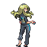 | uma garota da Maré | Raticate, Fearow, Kingler |
| 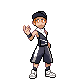 | Jory | Raticate, Golbat, Primeape, Granbull, Kingler |
| 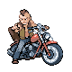 | um dos Faróis | Weezing, Rapidash, Muk |
| 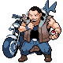 | Kaspar | Arbok, Weezing, Muk, Magmar, Houndoom, Ursaring |
| 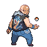 | Dekker | Primeape, Hitmontop, Hitmonchan, Golem, Machamp |

E quem não luta: o **Sargento Lund**, a Guarda das Ilhas inteira (`sevii_lund.png`), e o **Sr. Conrad Penrose**,
dono da fábrica de conserva fechada e patrocinador do torneio (`sevii_penrose.png`). Quem compra dele é a Casa Aster,
uma casa de leilão pequena de Goldenrod (a dona, a filha e um homem que bate à máquina), que vende pra quem tem coleção
com a procedência escrita à máquina. Nada da história de Kanto: o pós-jogo vale pra qualquer final. O pedido tem uma
remessa norte: as Ilhas do Redemoinho, em Johto.
